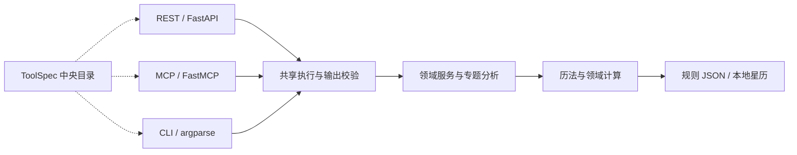

# FateBridge

<p align="center">
  
</p>

<p align="center">
  <strong>面向应用与 AI Agent 的传统术数与占星计算引擎</strong>
</p>

<p align="center">
  简体中文 · <a href="README.en.md">English</a>
</p>

<p align="center">
  <a href="https://pypi.org/project/fatebridge/"></a>
  <a href="pyproject.toml"></a>
  <a href="https://github.com/thomas-yanxin/FateBridge/actions/workflows/ci.yml"></a>
  <a href="LICENSE"></a>
  <a href="https://www.modelscope.cn/mcp/servers/thomas/FateBridge"></a>
  <a href="https://www.modelscope.cn/collections/thomas/Onda-Skills"></a>
</p>

<p align="center">
  <a href="#快速开始">快速开始</a> ·
  <a href="#mcp-部署">MCP 部署</a> ·
  <a href="#rest-api">REST API</a> ·
  <a href="docs/README.md">文档中心</a> ·
  <a href="#参与贡献">参与贡献</a>
</p>

FateBridge 是面向开发者与 AI Agent 的本地计算工具包，将八字、紫微、西方占星、中国占术与风水规则整理为结构化接口。同一套领域计算可通过 **MCP、REST API 和 CLI** 调用，返回计算数据、规则范围与运行回执，便于应用集成和结果核对。

计算服务无需 LLM API Key；自然语言对话由你选择的 Agent 客户端与模型提供。项目提供后端和 Onda 咨询技能，前端由接入应用实现。

## 目录

- [为什么使用 FateBridge](#为什么使用-fatebridge)
- [支持的能力](#支持的能力)
- [技术栈与运行前提](#技术栈与运行前提)
- [快速开始](#快速开始)
- [架构与项目结构](#架构与项目结构)
- [MCP 部署与 Onda 技能](#mcp-部署)
- [REST API](#rest-api)
- [配置、结果与精度](#配置结果与精度)
- [开发与测试](#开发与测试)
- [部署与升级](#部署与升级)
- [常见问题](#常见问题)
- [文档导航](#文档导航)
- [参与贡献](#参与贡献)
- [使用范围与许可](#使用范围与许可)

## 为什么使用 FateBridge

- **统一接入多种方法**：共享请求校验、工具目录、错误格式与计算回执，减少为不同体系单独编写接入代码。
- **让结果可检查**：保留时间、精度、规则来源及未覆盖范围；支持字段投影和同次计算结果的分页读取。
- **在自己的环境运行**：CLI 单次执行，MCP 由客户端启动，REST 可独立部署。安装依赖与下载星历需要网络；本地计算不依赖在线占算服务。
- **按问题组织 Agent 工作**：仓库中的 [Onda 技能](skills/README.md)提供事业、财务、关系、学习等主题的取证与解读流程，区分计算事实、传统解释和现实建议。

## 支持的能力

| 领域 | 主要内容 |
| --- | --- |
| 八字与双人关系 | 四柱命盘、事业与财务等九项专题、双人配合、宿曜相性 |
| 时运与历法 | 大运、流年、流月、流日、流时、节气与农历 |
| 中国术数与占卜 | 紫微、奇门、六壬、太乙、金口诀、梅花、六爻及本地技法 |
| 西方占星 | 本命与流派盘、关系盘、返照、行运、主限与时主等推运 |
| 风水空间 | 八宅、金锁基础砂水、年星、玄空历史宅盘，以及分层的布局与物件审查 |

当前源码提供 **86 个业务 REST 路由**、**87 个 FastMCP 工具**，覆盖 **13 family / 87 工具**。中央目录含 88 条记录，CLI 可执行其中 87 条。各端的名称与公开范围见[三端能力边界](docs/api-reference.md#24-三端能力边界)，逐项实现与限制见[算法覆盖矩阵](docs/algorithm-coverage.md)。

## 技术栈与运行前提

| 组成 | 技术与用途 |
| --- | --- |
| 语言与包管理 | Python 3.10+；uv 管理环境、依赖锁定与构建，源码默认使用 Python 3.12 |
| 服务与协议 | FastAPI / Uvicorn 提供 REST；FastMCP 提供 MCP；CLI 使用 argparse |
| 请求与响应合同 | Pydantic 2 与中央 `ToolSpec` 目录，共用校验、发现与执行流程 |
| 历法与占星 | pyswisseph / Swiss Ephemeris、Kerykeion 5、lunardate、pytz 等 |
| 规则与知识 | 随包分发的 JSON 数据；Onda 技能通过 Git 仓库另行分发 |
| 开发验证 | pytest、pytest-asyncio、Black、isort、mypy 与文档／合同检查脚本 |

实际依赖范围见 [pyproject.toml](pyproject.toml)，源码开发的解析版本由 [uv.lock](uv.lock) 固定。

首次使用需要联网安装依赖；下载外部星历时也需要网络。源码安装另需 Git。无需配置数据库、Redis、前端构建或 LLM API Key；大结果交付会按需写入本机私有临时文件，见[结果与精度](#输入结果与精度)。

## 快速开始

### 0. 准备 uv

尚未安装 uv 时，可按 [uv 官方安装说明](https://docs.astral.sh/uv/getting-started/installation/)选择安装方式。macOS / Linux：

```bash
curl -LsSf https://astral.sh/uv/install.sh | sh
```

Windows PowerShell：

```powershell
powershell -ExecutionPolicy ByPass -c "irm https://astral.sh/uv/install.ps1 | iex"
```

重新打开终端并运行 `uv --version` 确认安装。包要求 Python 3.10+，当前 CI 覆盖 3.10–3.13。下面的工具安装显式选择 Python 3.12，源码通过 `.python-version` 选择 3.12；缺少该解释器时 uv 可自动下载。

### 1. 安装

只使用已发布的 CLI、REST 或 MCP，从 PyPI 安装独立工具环境：

```bash
uv tool install --python 3.12 fatebridge
fatebridge doctor
```

安装提供 `fatebridge`、`fatebridge-api`、`fatebridge-mcp` 三个命令。若终端找不到命令，运行 `uv tool update-shell` 后重新打开终端。

**需要当前分支功能、Onda 技能或参与开发时，使用源码安装：**

```bash
git clone https://github.com/thomas-yanxin/FateBridge.git
cd FateBridge
uv sync --locked --extra dev
uv run --locked --extra dev fatebridge doctor
```

源码命令使用 `uv run --locked --extra dev` 前缀；下文无前缀的 `fatebridge` 命令面向独立工具安装。无需同时安装两种版本。本文描述当前开发分支，已发布包以[对应标签的文档](https://github.com/thomas-yanxin/FateBridge/tags)为准，未发布变化见 [CHANGELOG](CHANGELOG.md#unreleased)。**wheel 不包含 Onda 技能目录**，仅连接 MCP 不会自动安装这些技能。

### 2. 完成第一次计算

CLI 无需启动服务。以下使用虚构资料，macOS / Linux 可直接执行；PowerShell 多行命令见[部署指南](docs/mcp-deployment.md#windows-powershell)：

```bash
fatebridge bazi_birth \
  --birth-year 1990 --birth-month 5 --birth-day 15 \
  --birth-hour 10 --birth-minute 30 --gender 男 \
  --birth-place 北京 --birth-timezone Asia/Shanghai \
  --fields bazi_birth.day_master.stem \
    bazi_birth.day_master.element bazi_birth.day_master.polarity \
  --strict-fields --no-include-snapshot-text
```

退出码为 `0` 时，响应包含以下业务数据及 `run_metadata` 回执：

```json
{
  "bazi_birth": {
    "day_master": {"stem": "庚", "element": "金", "polarity": "阳"}
  }
}
```

### 3. 选择接入方式

| 你的目标 | 运行方式 | 下一步 |
| --- | --- | --- |
| 在 Codex、Claude Desktop、Cursor 中使用 | 本地 MCP / stdio，客户端管理进程 | [MCP 部署](#mcp-部署) |
| 为支持 URL 的 MCP 客户端提供服务 | FastMCP / Streamable HTTP，独立进程 | [HTTP MCP](#http-mcp) |
| 为 Web、移动端或自己的后端提供计算 | REST API，独立 HTTP 进程 | [REST API](#rest-api) |
| 批处理、脚本或终端调用 | CLI，运行后退出 | `fatebridge discover --family bazi`、`fatebridge describe bazi_birth --detail input` |

### 4. 查找工具与请求格式

用运行环境中的实际 Schema 确认参数，避免从不同接口或旧示例复制字段：

```bash
fatebridge discover --family bazi
fatebridge describe bazi_birth --detail input
fatebridge scenarios --scenario onda-shiye
```

源码用户为每条命令加 `uv run --locked --extra dev`。`describe` 返回输入定义与示例；省略 `--detail input` 时还返回输出合同。REST 可通过 `GET /api/tools` 查询目录，MCP 提供发现资源，详见[能力发现](docs/api-reference.md)。

## 架构与项目结构

三种接口通过中央目录绑定到领域服务，复用执行、输出校验和运行回执，再由各传输层处理协议与结果交付：



```text
FateBridge/
├── src/fatebridge/
│   ├── api.py / mcp_server.py / cli.py  # 三端入口
│   ├── application/                   # 发现、绑定、执行、投影与结果交付
│   ├── transports/                    # REST / MCP 协议注册
│   ├── services/catalog/              # 分领域工具声明
│   ├── services/                      # 领域编排与运行回执
│   ├── analysis/                      # 专题与复合分析
│   ├── core/                          # 算法、请求与输出模型
│   ├── data/                          # 随包规则与知识 JSON
│   └── utils/                         # 地点、时区、太阳时与文件等公共能力
├── skills/                            # Onda 咨询流程与共享资料
├── .agents/skills/                     # 项目技能发现入口
├── tests/                             # 领域、三端合同与回归测试
├── scripts/                           # 文档、生成合同与审计工具
├── docs/                              # 使用、部署、方法与开发指南
├── .env.example                       # 可选运行配置模板
├── pyproject.toml / uv.lock            # 包定义与开发锁文件
└── .github/workflows/                  # CI 与 PyPI 发布流程
```

以 `bazi_birth` 为例：参数经请求模型校验后，由 `ToolSpec` 绑定领域服务；共享执行层校验业务输出并附加 `run_metadata`，最后投影字段、处理快照和响应预算。三端复用计算，但路由、参数形状和公开范围仍以各端 Schema 为准。分层职责、重放与扩展流程见[架构说明](docs/architecture.md)。

## MCP 部署

### 本地 MCP：由客户端启动 stdio 进程

这是桌面 Agent 的直接接入方式。**无需启动 REST、开放端口或提前运行 `fatebridge-mcp`**。客户端根据配置启动子进程，通过标准输入输出通信；手工运行后等待输入属于正常行为。

先在选定的安装环境验证 MCP：

```bash
# PyPI 工具安装
fatebridge doctor --mcp

# 源码安装：在仓库根目录运行
uv run --locked --extra dev fatebridge doctor --mcp
```

二选一即可。`ok=true` 表示依赖、独立进程初始化、工具发现、资源读取和一条虚构计算通过。记录输出中的 **`executable` 绝对路径**，作为下面配置的 `command`；它指向已安装 FateBridge 的 Python，不依赖桌面客户端的 PATH 或工作目录。

#### Codex

将以下配置合并到 `~/.codex/config.toml`，替换解释器路径；已有 `fatebridge` 条目时编辑原条目：

```toml
[mcp_servers.fatebridge]
command = "/absolute/path/to/python"
args = ["-m", "fatebridge.mcp_server"]
startup_timeout_sec = 30
tool_timeout_sec = 60

[mcp_servers.fatebridge.env]
FATEBRIDGE_MCP_FAMILIES = ""
FATEBRIDGE_MCP_SCENARIOS = ""
PYTHONUTF8 = "1"
```

也可执行 doctor 返回的 `codex.add_command` 自动注册；该命令使用当前安装的绝对路径。桌面版与终端可能有不同 Codex CLI，优先使用 doctor 确认的路径。注册只需选择一种方式；细节见 [Codex 指南](docs/codex-guide.md#2-注册到-codex)与 [Codex 官方配置说明](https://developers.openai.com/codex/mcp)。

#### Claude Desktop / Cursor

将下面的 `fatebridge` 条目合并到客户端的 `mcpServers`，保留已有服务并替换解释器路径：

```json
{
  "mcpServers": {
    "fatebridge": {
      "command": "/absolute/path/to/python",
      "args": ["-m", "fatebridge.mcp_server"],
      "env": {
        "FATEBRIDGE_MCP_FAMILIES": "",
        "FATEBRIDGE_MCP_SCENARIOS": "",
        "PYTHONUTF8": "1"
      }
    }
  }
}
```

[Claude Desktop](https://modelcontextprotocol.io/docs/develop/connect-local-servers) 的配置文件为 macOS 的 `~/Library/Application Support/Claude/claude_desktop_config.json` 或 Windows 的 `%APPDATA%\Claude\claude_desktop_config.json`。[Cursor](https://cursor.com/docs/context/mcp) 使用项目级 `.cursor/mcp.json` 或用户级 `~/.cursor/mcp.json`；Cursor 的 stdio 条目还应加入 `"type": "stdio"`。

Windows 的解释器示例为 `C:\path\to\FateBridge\.venv\Scripts\python.exe`，JSON 中反斜杠写成 `\\`。完整 PowerShell 与配置示例见 [Windows 部署](docs/mcp-deployment.md#windows-powershell)。

#### 确认客户端可用

保存配置后重新加载 MCP 连接；必要时重启客户端并打开新聊天，检查 FateBridge 工具是否可见，再用虚构资料试调：

> 请使用 FateBridge，计算男、公历 1990 年 5 月 15 日上午 10:30、北京出生的八字，只解释日主的传统含义。

看到实际工具调用并成功返回，才完成客户端接入。配置存在或 doctor 通过均不能替代这一步。

默认公开全部工具。需要减小工具范围时设置 `FATEBRIDGE_MCP_SCENARIOS=onda-shiye`（事业），或 `FATEBRIDGE_MCP_FAMILIES=fengshui`（风水）；两个筛选取交集，空值表示不限制。修改后重启 MCP。场景列表可用 `fatebridge scenarios` 查询。

### HTTP MCP

支持 URL 的客户端可通过 FastMCP 运行同一个 `app`。**以下是源码安装方式**，在仓库根目录启动并保持进程运行：

```bash
uv run --locked --extra dev fastmcp run src/fatebridge/mcp_server.py:app \
  --transport http --host 127.0.0.1 --port 8011 --path /mcp
```

MCP URL 为 `http://127.0.0.1:8011/mcp`。`fatebridge-mcp` 入口本身仍使用 stdio；HTTP 参数属于 [FastMCP runner](https://gofastmcp.com/deployment/running-server)。REST 的 `8010` 端口与 MCP 的 `8011` 端口是两个独立服务。

远程机器可保持监听回环地址，通过 SSH 隧道接入。完整 URL 配置、协议验证和常驻进程示例见 [MCP 部署指南](docs/mcp-deployment.md#http-与远程部署)。**REST 的 `FATEBRIDGE_API_KEYS` 不保护 MCP**；公网服务需要另行配置 TLS、MCP 鉴权与访问限制，当前示例不提供多租户隔离。

### 使用 Onda 咨询技能

MCP 提供计算工具，Onda 提供按问题组织咨询的技能。使用源码仓库作为 Codex 项目时，仓库的 `AGENTS.md` 与 `.agents/skills/` 提供项目指导和技能入口；在新聊天确认发现状态。其他客户端需要按其技能机制加载 `skills/` 中的内容，不会因 MCP 连接自动获得这些文件。详见 [Onda 技能索引](skills/README.md)。

ModelScope 入口：[FateBridge MCP Server](https://www.modelscope.cn/mcp/servers/thomas/FateBridge) · [Onda Skills 合集](https://www.modelscope.cn/collections/thomas/Onda-Skills)。平台接入按对应页面说明操作，本地安装与配置按本文流程进行。

## REST API

安装后启动本机服务。macOS / Linux：

```bash
API_HOST=127.0.0.1 fatebridge-api
# 源码安装：API_HOST=127.0.0.1 uv run --locked --extra dev fatebridge-api
```

Windows PowerShell：

```powershell
$env:API_HOST = "127.0.0.1"
fatebridge-api
```

另开终端检查服务并执行与 CLI 相同的虚构计算：

```bash
curl --fail http://127.0.0.1:8010/health
curl --fail http://127.0.0.1:8010/ready
curl --fail 'http://127.0.0.1:8010/api/cn/bazi/birth?fields=bazi_birth.day_master&strict_fields=true&include_snapshot_text=false' \
  -H 'Content-Type: application/json' \
  -d '{
    "birth_year": 1990, "birth_month": 5, "birth_day": 15,
    "birth_hour": 10, "birth_minute": 30, "gender": "男",
    "birth_place": "北京", "birth_timezone": "Asia/Shanghai"
  }'
```

`/health` 返回 `{"status":"healthy"}`；命盘结果位于 `bazi_birth.day_master`，另附 `run_metadata`。`/ready` 表示必需检查就绪，不等于所有算法或星历均已验证。[Swagger UI](http://127.0.0.1:8010/docs)可查看 Schema 与试调请求。

监听默认值为 `0.0.0.0:8010`，上例显式限制为本机。共享部署前设置 `FATEBRIDGE_API_KEYS=client:replace-with-a-secret`，业务请求发送 `X-API-Key: replace-with-a-secret`，并在网关处理 TLS、访问和请求速率。密钥不提供用户账户或结果所有权隔离；`/health`、`/ready`、`/metrics` 与接口文档等运维路径免鉴权，详见[安全策略](SECURITY.md#scope-notes)。

## 配置、结果与精度

### 环境变量

基础 CLI 计算无需 `.env`。源码 API / MCP 可按需复制模板（macOS / Linux；已有文件时保留）：

```bash
cp -n .env.example .env
```

| 设置 | 默认值 | 用途 |
| --- | --- | --- |
| `API_HOST` / `API_PORT` | `0.0.0.0` / `8010` | REST 监听地址与端口；本机使用设为 `127.0.0.1` |
| `FATEBRIDGE_API_KEYS` | 空，关闭鉴权 | REST 共享密钥，格式如 `client:secret`；多个用逗号分隔 |
| `API_KEY_HEADER_NAME` | `X-API-Key` | REST 密钥请求头；发送 `secret`，不含 `client:` 前缀 |
| `ALLOWED_ORIGINS` | `http://localhost:3000` | 逗号分隔的浏览器 CORS 来源 |
| `FATEBRIDGE_MCP_FAMILIES` / `FATEBRIDGE_MCP_SCENARIOS` | 空，不筛选 | MCP 工具族／场景筛选，取交集；不改变 REST / CLI |
| `SE_EPHE_PATH` | 未设置，尝试本地 `ephe/` | 指定星历目录；不在 `.env.example` 中 |
| `FATEBRIDGE_HEAVY_CALC_MAX_CONCURRENCY` | `min(4, max(1, CPU 数))` | 单 REST 进程重计算并发上限，至少为 1；不提供请求速率限制 |
| `LOG_LEVEL` | `INFO` | 日志级别 |

源码 API / MCP 会读取仓库根目录 `.env`，进程环境变量优先；文件只解析简单 `KEY=value`、包裹引号和整行注释，不执行 shell 展开。CLI 不自动读取 `.env`。独立工具安装请在启动器或客户端 `env` 中显式注入配置，修改后重启相应服务。加载规则与鉴权示例见[快速入门](docs/getting-started.md#配置环境变量)。

### 星历数据

需要外部 Swiss Ephemeris 数据时，源码用户在仓库根目录运行：

```bash
uv run --locked --extra dev python -m fatebridge.fetch_ephe
```

默认下载三个 `.se1` 文件到仓库 `ephe/`。其他年代或天体可能需要额外文件；数据许可独立于项目代码。独立工具用户使用[自定义目录下载流程](docs/getting-started.md#星历数据与精度)，并在服务启动环境设置 `SE_EPHE_PATH`。数据准备后重启服务，核对实际返回的星历模型。

### 输入、结果与精度

- **输入**：出生接口使用公历；按各工具 Schema 提供小时、时区和地点，不能把未知出生时刻补成零点。中式出生计算默认开启真太阳时，西占核心盘默认使用民用时刻；保留实际解析和精度提示。
- **结果**：先检查 MCP `isError`、REST 状态码或 CLI 退出码，再读取业务字段。`fields` 支持点路径投影，`strict_fields=true` 拒绝无效路径；REST 投影选项放在 query，而非 JSON body。
- **完整导出**：完整 JSON 首次调用设置 `fields=null`。MCP 默认预算为 8192 字符，超限后按 `result_delivery` 读取同一 run；未被首次选中的字段不能事后恢复。详见[同次完整导出](docs/agent-guide.md#完整结果交付与同次导出)。
- **精度与复现**：保留原输入与 `run_metadata`。外部 `.se1` 星历不随 wheel 分发；检查 `chart_profile.ephemeris_model` 与 `run_metadata.engine_is_approximate`，不能仅凭依赖可导入就认定加载了高精度数据。重现还需匹配实现、数据与环境，见[星历说明](docs/getting-started.md#星历数据与精度)。

大结果交付按需写入当前系统用户的私有临时目录，无需数据库。当前实现的有效期为 1 小时，目录总容量上限为 64 MiB，容量不足时可提前淘汰旧结果；这是临时交付机制，需要留存的结果应及时导出。它不提供加密或按应用用户隔离，文件格式、分页与校验步骤见[完整结果交付](docs/agent-guide.md#完整结果交付与同次导出)。

## 开发与测试

先完成[源码安装](#1-安装)，以下命令均在仓库根目录执行。无需激活虚拟环境：

| 任务 | 命令 |
| --- | --- |
| 同步锁定开发环境 | `uv sync --locked --extra dev` |
| 检查锁文件 | `uv lock --check` |
| 查看版本、解释器与依赖 | `uv run --locked --extra dev fatebridge doctor` |
| 验证独立 stdio MCP | `uv run --locked --extra dev fatebridge doctor --mcp --scenario onda-shiye` |
| 启动本地 REST（macOS / Linux） | `API_HOST=127.0.0.1 uv run --locked --extra dev fatebridge-api` |
| 执行全部测试 | `uv run --locked --extra dev python -m pytest -q` |
| 执行三端对齐测试 | `uv run --locked --extra dev python -m pytest -q tests/test_api_alignment.py` |
| 检查代码格式 | `uv run --locked --extra dev black --check src/fatebridge scripts tests` |
| 检查导入顺序 | `uv run --locked --extra dev isort --check-only src/fatebridge scripts tests` |
| 检查类型 | `uv run --locked --extra dev mypy src/fatebridge/` |
| 构建 sdist / wheel | `uv build` |

`tests/` 包含领域回归、输入／输出合同、三端对齐、结果交付、文档与技能检查；`tests/golden/` 保存数值基线。先运行与改动相关的文件，也可用 `uv run --locked --extra dev python -m pytest -q tests/test_api_alignment.py -k relative_chart` 选择关系盘用例。

**纯文档改动**可从以下检查开始；生成区只通过脚本更新：

```bash
uv run --locked --extra dev python scripts/check_docs.py
uv run --locked --extra dev python scripts/build_scenario_manifest.py --check
uv run --locked --extra dev python scripts/build_codex_call_contracts.py --check
uv run --locked --extra dev python -m pytest -q \
  tests/test_documentation_integrity.py tests/test_doc_tool_counts.py \
  tests/test_scenario_routing_coverage.py tests/test_skills_interface_contract.py \
  tests/test_skills_engine_contract.py tests/test_codex_call_contracts.py \
  tests/test_ci_scope.py
git diff --check
```

CI 的锁定环境检查与 Python 3.10–3.13 最新依赖矩阵、最低直接依赖检查分开运行；另有 Windows / Python 3.12 的启动与存储检查。仅修改普通文档的 PR 使用文档检查分支，主分支 push 运行全量检查。黄金字节比对限定 Linux x86_64 / Python 3.12 参考环境，本地其他平台跳过不代表该项已通过。完整规则见[测试策略与 CI 范围](docs/development-guide.md#ci-运行范围)。

## 部署与升级

### 选择运行环境

本地 stdio MCP 由客户端管理进程；REST 与 HTTP MCP 需要独立常驻服务。当前仓库没有提供 Dockerfile 或 Compose 文件。容器部署建议按 [uv 官方 Docker 指南](https://docs.astral.sh/uv/guides/integration/docker/)构建自己的镜像：复制源码、包定义与锁文件，用 `uv sync --locked --no-dev` 安装运行环境，并以非 root 用户运行选定入口。容器内 HTTP 服务需监听 `0.0.0.0`；宿主机端口映射与网关决定外部访问范围。星历应在构建时单独准备或作为数据卷挂载，临时结果目录须可写。

直接部署 Linux 主机时，先在固定目录建立源码环境，再用 systemd 等进程管理器运行 `.venv/bin/fatebridge-api` 或 FastMCP HTTP runner；MCP 的 unit 模板见[常驻部署](docs/mcp-deployment.md#常驻与公网边界)。运行用户需要访问实际 Python、源码、星历与私有临时目录。环境变量在服务配置中显式注入；REST 密钥、网络访问与运维端点范围见[安全策略](SECURITY.md#scope-notes)。

### 验证与运维

- REST：检查 `/health`、`/ready`，执行一次本文的虚构请求；`/metrics` 提供当前进程的 Prometheus 指标。
- HTTP MCP：使用 MCP 客户端完成初始化、发现与工具调用；普通浏览器 GET `/mcp` 不能替代协议验收，见[HTTP 验证示例](docs/mcp-deployment.md#http-与远程部署)。
- 故障定位：记录 doctor 的版本、解释器与包路径，结合服务管理器日志；回执和日志对外分享前脱敏。

### 升级与回退

升级前保存版本／提交、服务配置和仍需保留的导出文件。独立工具使用 `uv tool upgrade fatebridge`；源码用户先保留本地改动，再用 `git pull --ff-only` 与 `uv sync --locked --extra dev` 更新。随后重新运行 doctor 与协议验证，重启服务或客户端连接，并核对实际加载的版本。

回退时选定已确认的发布版本或 Git tag / commit，在独立环境安装并切换服务路径；具体固定版本、停用与卸载命令见[升级与回退指南](docs/mcp-deployment.md#升级回退与停用)。CI 成功后是否发布 PyPI 取决于该提交的包版本是否尚未发布；普通源码更新不一定产生新的 PyPI 版本，详见[打包发布流程](docs/development-guide.md#ci打包与发布)。

## 常见问题

| 现象 | 处理 |
| --- | --- |
| `fatebridge` 找不到 / GUI 启动失败 | 工具安装运行 `uv tool update-shell`；GUI 使用 doctor 的 `executable` 绝对路径 |
| `fatebridge-mcp` 没有输出、一直等待 | stdio 正在等待客户端消息；将其注册到客户端，或使用上面的 HTTP runner |
| MCP 工具缺失或新参数不可见 | 核对 family / scenario 交集、实际包路径，重启连接并打开新聊天 |
| 将 `http://localhost:8010` 填入 MCP 后失败 | 该地址是 REST；stdio 填 `command/args`，HTTP MCP 使用对应的 `/mcp` URL |
| 返回 `partial`、近似或依赖错误 | 按实际 coverage、精度和错误字段核对所需输入、后端与星历 |
| REST 返回 `401` | 核对服务密钥配置与请求头；发送 secret 部分，不带名称前缀 |
| `strict_fields` 拒绝字段或返回参数错误 | 用当前环境的 `describe <tool> --detail input` 核对请求；输出路径查完整 `describe`，REST 投影选项放 query |
| 星历下载或本地目录访问失败 | 核对网络、目录写权限与服务用户；已下载文件还须在启动环境中设置正确路径 |
| 大结果引用失效 | 核对有效期与容量淘汰；临时交付物需及时导出，不能用新计算冒充原 run |

更多恢复步骤见[故障排除](docs/troubleshooting.md)，MCP 的升级、停用与部署验证见[部署指南](docs/mcp-deployment.md)。

## 文档导航

| 你想做什么 | 阅读入口 |
| --- | --- |
| 安装、配置、下载星历 | [快速入门](docs/getting-started.md) |
| 部署本地或远程 MCP | [MCP 部署指南](docs/mcp-deployment.md) |
| 在 Codex 中完成咨询 | [Codex 指南](docs/codex-guide.md) · [Onda 技能](skills/README.md) |
| 编写应用与 Agent 集成 | [接入指南](docs/agent-guide.md) · [API 参考](docs/api-reference.md) |
| 查实现范围、方法与精度 | [算法覆盖](docs/algorithm-coverage.md) · [核心概念](docs/concepts.md) |
| 查主题路由、规则与示例 | [场景路由](docs/scenario-routing.md) · [示例索引](docs/examples/README.md) · [规则文档](docs/README.md#理解计算与结果) |
| 开发、迁移或定位问题 | [架构](docs/architecture.md) · [开发指南](docs/development-guide.md) · [迁移指南](docs/migration.md) · [故障排除](docs/troubleshooting.md) |

全部文档见[文档中心](docs/README.md)，版本变化见 [CHANGELOG](CHANGELOG.md)。

## 参与贡献

欢迎算法修正、接口改进、测试、文档和技能贡献。先按[开发与测试](#开发与测试)建立环境并选择检查范围；代码改动按影响补齐领域测试与三端合同验证。依赖变更使用 `uv add` / `uv remove`，同时提交 `pyproject.toml` 与 `uv.lock`。

开发与 PR 流程见[贡献指南](CONTRIBUTING.md)。通过 [Issues](https://github.com/thomas-yanxin/FateBridge/issues)报告问题时，附版本、系统、最小虚构输入与实际错误；安全问题按 [SECURITY.md](SECURITY.md)私下报告。

## 使用范围与许可

传统解释与分数用于文化参考，分数不代表现实成功概率。计算测试验证历法、数值和所选规则的一致性，不证明预测有效性。咨询不提供生死寿命、灾祸断言、临床诊断治疗与医疗择时，详见[咨询硬边界](skills/_shared/safety-boundaries.md)。

本地运行仍需考虑 Agent 客户端、模型服务、聊天记录与导出文件对资料的处理；真实出生资料不应提交到公开 Issue 或仓库。

项目代码采用 [Apache-2.0](LICENSE)，第三方组件与来源见 [NOTICE](NOTICE)。依赖与星历数据遵循各自许可，分发或商用集成时需分别核对。

[返回顶部 ↑](#fatebridge)
