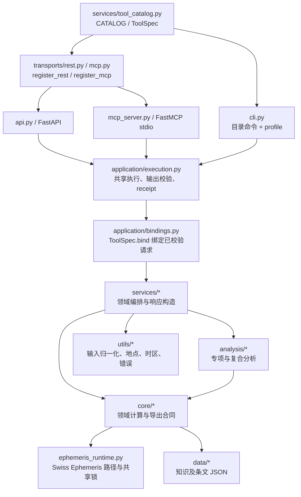
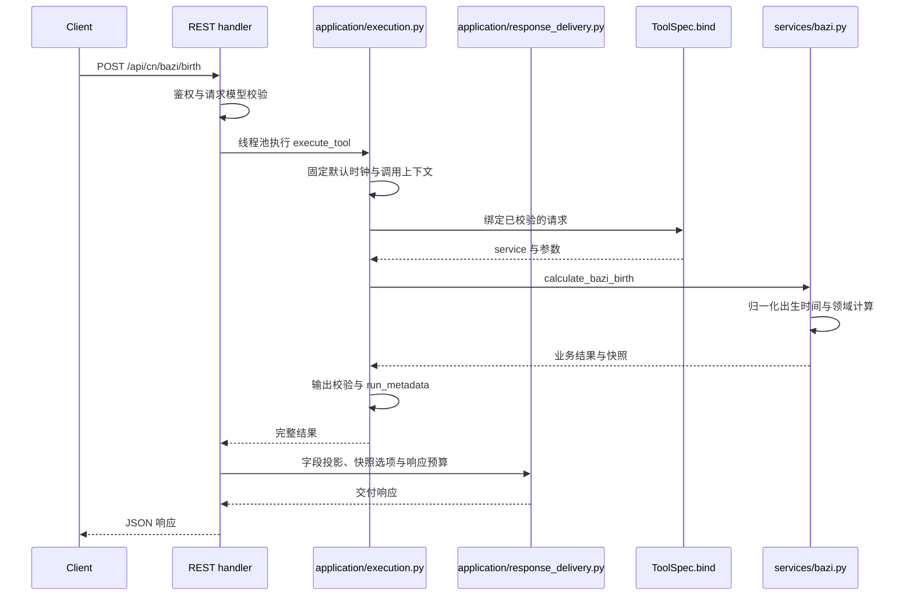

# FateBridge 架构说明

[文档中心](README.md) · [开发指南](development-guide.md) · [核心概念](concepts.md)

一次计算会经过接入校验、共享执行、领域服务与结果交付。沿着这条链路，可以追溯响应从何而来、找到扩展或修复的位置，并判断哪些接口与合同需要一起验证。首次接入从[快速入门](getting-started.md)开始，字段与路由查询使用 [API 参考](api-reference.md)。

FateBridge 的 Python 后端通过 REST、MCP 和 CLI 提供领域计算；仓库提供按需读取的方法参考。对话模型和产品界面由接入应用提供，整体分工见[核心概念](concepts.md#计算解读与对话的分工)。

`src/fatebridge/services/catalog/` 按领域声明工具，`services/tool_catalog.py` 有序装配成唯一的 `CATALOG`；请求字段定义于 `core/requests/` 的领域模块。传输层复用服务和算法，但保留各端的绑定、名称和校验方式。

阅读导航：[系统概览](#系统概览) · [分层职责](#分层职责) · [典型请求流](#典型请求流) · [关键实现约束](#关键实现约束) · [依赖边界](#内聚与依赖边界) · [运行边界](#运行配置与边界) · [扩展验证](#扩展与验证)

## 系统概览

下图展示计算请求的后端执行链路。模型对话与结果解释在客户端或应用侧完成。

`application/tool_spec.py` 的 `ToolSpec` 是冻结 dataclass，包含 key、family、请求与输出模型、绑定器、各端名称、必需业务根和重计算标记。`core/response_models.py` 定义公开根契约，复用 `core/output_western.py`、`output_charts.py`、`output_chinese.py`、`output_bazi.py`、`output_reference.py` 的专业嵌套模型；它们继承 `output_base.PartialOutput`，支持部分响应、可空事实与增量扩展，只校验而不重写业务 JSON。目录将输出模型附到 ToolSpec；`rest_specs()` / `mcp_specs()` 过滤各端集合，注册器据此挂载入口，CLI 按模型生成参数。新增工具须同时声明响应字段契约。

`application/discovery.py` 在生成 Schema 前筛选目录，供 REST `/api/tools`、CLI `discover` 和 MCP 摘要/单工具资源共用。MCP host 的 family 配置只筛选注册表；默认保留完整集合。`ToolSpec.execution_hints` 是三端发现记录与 MCP annotations 的共同来源，描述环境影响，不描述数值确定性。

当前 FastAPI 提供 91 个业务 REST 路由，另有 `GET /api/tools` 发现接口与 `/health`、`/ready`、`/metrics` 运维端点；FastMCP 默认提供 92 个 MCP 工具。中央目录包含 93 条记录，CLI 可执行其中 92 条。CLI 另有 `list`、`discover`、`describe`、`profile`、`doctor`；风水工具明确启用嵌套 JSON `--request-file`，关系盘嵌套入口仍使用已有扁平变体。

家居风水领域位于 `core/fengshui/`，请求、响应、公共方位、历法边界、八宅、年度飞星、玄空历史宅盘、砂水与可读快照各有模块。`services/fengshui.py` 只编排独立层和逐人差异，`data/fengshui/rules-v1.json` 保存版本与来源并随包发布。工具在中央目录显式绑定领域响应模型；`cli_request_file` 声明复杂 CLI 输入支持，不改变未启用工具的行为。规则与验收边界见 [家居风水](fengshui.md)。

目录声明让领域能力共用信源，不意味着所有端逐项同名同形：独立八字命盘使用 `/api/cn/bazi/birth`，`analyze_destiny` 是 MCP / CLI 综合命理；关系盘 REST 使用嵌套对象，MCP / CLI 使用扁平字段。具体映射见 [API 参考](api-reference.md#24-三端能力边界)。

## 分层职责

| 层 | 主要路径 | 职责 |
| --- | --- | --- |
| 工具声明 | `services/catalog/`、`services/tool_catalog.py`、`application/tool_spec.py` | 领域声明、中央装配与不依赖协议框架的工具描述 |
| 应用编排 | `application/bindings.py`、`execution.py`、`response_delivery.py` | 请求绑定、统一执行与输出校验、投影和预算交付 |
| 能力发现 | `application/description.py`、`discovery.py` | 公共描述与目录筛选；共享描述避免反向引用 |
| 协议注册 | `transports/rest.py`、`transports/mcp.py` | REST/MCP 签名、注册、协议错误与输出选项 |
| 请求模型 | `core/requests/` | 公共校验基类、领域字段、默认值与取值范围 |
| 传输 | `api.py`、`mcp_server.py`、`cli.py` | HTTP/协议/参数处理，错误、元数据与输出包装 |
| 服务 | `services/*.py` | 调用核心、拼接分析、生成快照；`run_metadata.py` 生成响应溯源 |
| 分析 | `analysis/*.py` | 婚姻、事业、健康等专项及配合度/时运复合规则 |
| 核心 | `core/*.py`、`core/metaphysics/` | 历法、八字、占星、紫微、六壬、太乙等领域计算 |
| 子技法 | `core/predictive/`、`core/local_techniques/` | 西占推运和本地技法模块；两者均为目录，不是旧单文件模块 |
| 运行公共层 | `utils/birth_input.py`、`solar_time.py`、`formatting.py`、`elements.py`、`places.py`、`timezones.py`、`runtime.py`、`errors.py` | 出生输入、太阳钟、展示、五行关系、地点/时区、配置与错误 |
| 星历运行时 | `core/ephemeris_runtime.py` | 数据路径、模型标识、共享状态与并发保护 |
| 数据 | `data/knowledge/`、`data/canping/`、`data/heluo/` | 知识与条文 JSON，打包进 wheel |
| 导出 | `core/export_contracts.py`、`export_parser.py`、`services/structured_snapshot.py` | section 合同、文本解析与快照构造 |
| 验证 | `tests/`、`tests/data/` | 领域回归、独立参考、跨端对齐与文档契约 |

## 典型请求流

### 独立八字命盘

`api.py` 不直接手工构造领域对象。`ToolSpec.bind` 通过公共绑定器构造请求，再交服务执行。REST 同步服务均在线程池执行，并在提交重计算前异步限流。`application/compute_limits.py` 在共享执行层用同一进程信号量限制 `cpu_bound` 工作，REST、MCP和CLI均遵守；上限来自 `FATEBRIDGE_HEAVY_CALC_MAX_CONCURRENCY`。发现记录的 `execution` 披露是否计入该预算。它限制进程内实际计算，不是跨进程队列或速率限制。

`analyze_destiny` 的 MCP / CLI 绑定进入 `services/calculation.py::calculate_destiny_analysis`，在命盘之上组织综合分析。独立八字命盘绑定到 `services/bazi.py::calculate_bazi_birth`。

### 快照与输出流

一次成功请求依次经过业务输出校验、执行回执、字段投影、快照选项和响应预算处理。这一顺序决定了保存与交付的数据范围。

支持双层快照的服务生成可读的 `snapshot_text` 与 `snapshot_export`，使用 `parse_export_content` 或共享快照构造器；部分工具只有文本或结构化数据，覆盖见 [算法矩阵](algorithm-coverage.md#4-快照协议覆盖)。`selected_sections` 只筛选导出文本，完整业务数据与原快照仍在。显式选择没有命中时导出为空，不回退全文。

成功业务输出由共享模型验证，保留原有字段与数值。共享执行层附加 `run_metadata` 后，`application/response_delivery.py` 统一执行字段投影、顶层 `snapshot_text` 选项和响应预算；三端只负责参数绑定、序列化与错误表达。错误结果保留完整包络，不做字段投影或分页。MCP 返回 structuredContent、JSON text 和原生 isError；REST 返回 JSON 对象，CLI 写 stdout 并用退出码表达失败。MCP 前置 middleware 将模型错误转换为安全的统一字段提示，避免框架回显提交内容。完整选项见 [API 参考](api-reference.md#25-字段投影与输出体积)。

### 合同缓存

`core/schema_cache.py` 缓存公开 Schema：按实际模型类、core schema 身份及完整结果必需根声明区分，每类缓存最多 256 条；模型 `model_rebuild()` 后自动使用新版本，公开 Schema 返回深拷贝。

动态修改模型配置、Schema hook 或嵌套模型而未重建根模型时，需要调用 `clear_contract_caches()`。业务输入、输出、调用时间和 execution receipt 仍逐次生成。输出在领域返回后、receipt 附加后分别校验；完整执行必须包含非null且不只是空对象的 `ToolSpec.required_output_fields`。共享 `PartialOutput` 根据完整执行上下文递归核验Schema中的 `FullFact`／`PresentFact`、集合唯一性及必要成员；完整执行仍核对这些声明与空对象政策。公共投影验证仍允许省略对象字段，合法空列表按各领域合同保留。异常错误包络按内部输出错误处理。REST 不再重复第三次校验同一完整结果。

### 大结果交付

`application/result_delivery.py` 将超预算结果写入按操作系统用户隔离的私有临时目录。保留范围是投影与快照选项处理后的响应，不能从摘要交付恢复未选字段；完整导出须首次保留完整范围。原 JSON 保留 `payload`，字符分页用 UTF-8 字节边界索引 seek 原正文，散列与小型 manifest 在写入时生成；字段展开首次定位后仅保存索引，不复制正文或无限缓存用户结果。

跨进程锁覆盖容量预留、提交、普通索引分页与回收，容量计量包含已提交 sidecar。POSIX 使用 owner-only 权限和 flock；Windows 通过平台限定的 pywin32 使用用户 SID、私有 ACL 与原生文件锁，拒绝重解析点。缺少当前索引元数据的旧记录返回 `result_unavailable`，不会自动升级或改写；临时原子替换文件可能增加瞬时磁盘峰值。此机制提供同 run 展开，不提供咨询事实继承；`parent_run_id` 仍只是关联标记。

确定性校验读取以元数据最后提交的既有结果为输入，无需可写锁或临时目录探测。它先验证私有文件、期限、原完整payload散列、run、清单一致性和工具公开范围，再从同一内存对象选页；并发回收可令结果不可用，不能将不一致数据认证为原结果。导入存储模块不选择可写临时目录，写入时才按既有策略选择；只读客户端按结果ID发现既有缓存，存在歧义就拒绝，CLI可显式指定原私有目录。

原生 MCP 从投影后的字典直接生成 structuredContent 和 JSON text，不经过文本反解析。协议工具仅通过原生 FastMCP 调用，REST 通过已挂载路由调用；旧 Python 别名和模块级 `.fn` 包装已删除。内部导入使用定义模块（如 `utils.errors`、`core.requests`、`core.predictive` 的具体子模块），不依赖兼容重导出。

## 关键实现约束

### 出生时间与分析时钟

出生输入构造与校验集中在 `utils/birth_input.py`，太阳时归一化集中在 `utils/solar_time.py`，时区解析集中在 `utils/timezones.py`。中式出生模型默认开启太阳时、核心星盘默认关闭；缺省值和用户显式选择有不同的缺经度处理，不可在适配层丢失。四柱年/月与节气、起运按实际民用时刻，日/时柱等遵循太阳钟规则；应保留原始时刻与修正结果供复核。

### 星历模型与共享状态

核心占星可走本地 `swisseph` 或轨道近似路径，显式复杂宫制缺运行时则报错。西占推运、事件和生命周期依赖 backend，缺失时不使用 FateBridge 的轨道近似替代。包可导入仍不保证星历数据存在，实际模型需检查 `ephemeris_model` 与 `engine_is_approximate`，详见 [算法覆盖](algorithm-coverage.md)。

Swiss Ephemeris 存在共享 C 状态。直接调用与会修改目录的第三方调用通过 `ephemeris_runtime.py` 的可重入锁协调；第三方操作正常或异常结束都应恢复配置目录。新增星历调用应复用这一层，避免跨请求的目录漂移。

### 执行回执与重放

`run_metadata` 在原 ID、时间、引擎与近似标志上增加版本、实际时间与重放参数。`application/execution.py` 的 `execute_tool` 包装现有 `execute_spec`，REST 由原执行器限制重计算并发并卸载到线程，MCP / CLI 共用执行层；execute_spec 保留无元数据的服务调用契约。ContextVar 隔离默认时钟，无 seed 随机六爻保留本次 seed，没有运行数据库。重放需要保存原始请求和环境，`run_id` 本身不能查询或恢复一次计算。

### 工具发现

工具发现直接从实时 `ToolSpec` 目录生成。REST、CLI 与 MCP 资源按名称、family、关键词和接口筛选；MCP 可用 `FATEBRIDGE_MCP_FAMILIES` 限制注册范围。发现层不加载主题 YAML、生成的场景清单或预设工具依赖。

### 方法合同与数量语义

`core/method_contracts.py`与`services/method_registration.py`维护领域方法合同。当前92个工具登记65个共享领域方法；人格入口明确排除。完整发现返回`method_contracts/method_registration`，摘要返回`method_ids`；运行时实际策略版本与见证路径另记入`run_metadata.calculation_evidence`。

共享证据层绑定全部业务根、输入提供状态和环境，解析已有领域账本中的具名依赖，检查DAG闭合并支持保守失效传播。误差预算区分已知界、声明范围、未量化和不适用；没有传播依据时不生成输出误差界。声明依赖、包含与规则输入见证分开，未决语义依赖保持显式，详见[计算证据合同](computation-evidence.md)。完整业务覆盖不等于全部细粒度因果关系或连续稳定性已被证明。

## 内聚与依赖边界

入口和协议适配器调用应用层，应用层调用领域服务，领域服务调用 `core`、`analysis` 与公共工具。`services/tool_catalog.py` 是装配入口，可以依赖应用层的 `ToolSpec` 与绑定工厂；普通领域服务不依赖协议适配器。`application` 不导入 FastAPI / FastMCP，动态协议签名由 `transports` 生成。

| 关注点 | 当前模块与维护规则 |
| --- | --- |
| 出生公共计算 | `services/birth_context.py` 复用归一化、四柱与历法；`birth_payload.py` 构造公共命盘响应 |
| 时运与日历 | `services/timing.py` 编排时运，`timing_clock.py` 归一化分析时刻并读取 `core.execution_context` 的执行时钟，`timing_state.py` 计算各层状态，`timing_snapshots.py` 组织文本；日历查询用 `calendar_tools.py` / `calendar_input.py` |
| 星盘 | `core/astro/` 按出生、几何、星历、宫位、盘面与关系盘拆分；公共星座、庙旺和界表位于 `core/astrology_tables.py` |
| 请求模型 | `core/requests/base.py` 管理未知字段和日期校验；`birth.py` 管理出生基类，领域模块直接导入所需类型 |
| 工具声明 | `services/catalog/` 各领域拥有 `SPECS`、绑定和延迟服务代理；不反向导入中央装配器或提前加载计算引擎 |
| 西占单项时运 | `services/western_timing_tools.calculate_timing_tool` 承担共同执行；目录通过绑定参数选择技法，标签与公开入口仍由各条 `ToolSpec` 声明 |
| 本地技法快照 | `core/local_techniques/snapshot.py` 提供共享文本原语；纯四卦组合不为渲染文本加载星盘计算入口 |
| 输入与展示 | `utils/birth_input.py`、`solar_time.py`、`formatting.py`、`elements.py` 各自承担单一公共职责 |
| 领域共享定义 | 河洛卦关系、人类图 mechanics、六壬约定、金口诀表与太乙几何由各领域的定义模块维护；计算入口和规则消费者共同依赖定义模块 |
| 人类图知识 | `human_design_line_catalogue.py` 维护基础目录，版本化读者依赖基础目录；`human_design_knowledge.py` 负责版本分派 |
| 星历来源 | `physical_source_observation.py` 记录来源，`physical_ephemeris_policy.py` 管理外层策略；运行时向策略与压缩星历传入实际 native 对象、探测和路径回调 |
| 完整结果校验 | 金口诀完整课体的气状态校验与参平年序绑定分别由 `output_jinkou_course_qi.py`、`canping_schedule_validation.py` 承担；字段模型与底层规则不反向导入完整输出模型 |

共享定义留在对应领域，避免消费者为了取常量、类型或纯计算函数导入完整排盘入口。函数内导入同样计入依赖图；延迟导入用于控制加载成本，不用于隐藏循环依赖。当前实现按独立参考、完整业务输出及领域回归验证，验收方法见[开发指南](development-guide.md#测试策略)。

`tests/quality/test_architecture_boundaries.py` 检查核心/分析/工具层不依赖应用与协议层、应用与服务不依赖协议适配器或旧兼容入口，并核对含函数内导入的静态导入图无循环。它不分析动态 `importlib` 调用或第三方库内部依赖。

## 历法与星历依赖

修改共享历法时，先沿实际消费路径确定影响范围。下表列出已核对入口，并非穷尽所有间接调用。数值、时标、民用转换及边界两侧的领域分类分别验证；不同模型的通过结果不能抵销原模型失败。

| 依赖 | 已核对的消费路径 | 修改时重点 |
| --- | --- | --- |
| `core/almanac.py` 的节气年表和相邻节气 | `services/calendar_tools.py`、`core/timing.py`、`core/metaphysics/ren_calendar.py`、`core/liuyao_calendar_models.py`、`core/fengshui/calendar.py`、`core/fengshui/monthly_time.py` | 分别检查实际提供者、TT 交点、民用时间转换及各消费者在边界两侧的分类；参见[六壬审计](liuren-jinkou-audit.md)与[风水历法审计](fengshui.md)。 |
| 同一节气年表的河洛／参评路径 | `core/heluo_solar_context.py`、`core/heluo_seasonal.py`、`core/canping_solar.py` | 河洛绑定当前节气、前一至点及下一四立；参评还取投影立春。保留实际消费的模型与来源，不能用另一路模型的通过结果改写 Native 失败。见[太阳模型边界](solar-backends.md)。 |
| 农历日期与时区 | `core/ziwei_age.py`、`core/ziwei_calendar.py` | 安星时钟、岁序参考时钟与目标流曜时钟各有职责；修改其中之一应检查其他输出是否被误改。见[紫微岁序](ziwei.md#时钟与岁序)。 |
| Swiss 星历与时间尺度 | `services/human_design.py` 及人类图计算链 | 按实际旗标和文件核对出生及设计时刻，分别检查后端对坐标、太阳根和细分的影响；不能仅以可导入库判断使用了数据文件。见[人类图验收](human-design.md)。 |

这些路径共享某些基础组件，不意味着它们的全部历法策略、覆盖年份或后端选择相同。扩展影响范围时应沿实际调用链核实。

### 星历路径解析的一致性

`core/ephemeris_paths.py` 统一处理星历目录列表，供安装提示、`doctor` 的风水／人类图检查、节气缓存、运行来源记录及梅花历法审计使用。Unix 同时支持冒号和分号，Windows 保留盘符冒号；原有目录顺序和相对路径含义保持。路径约定参照 [Swiss 官方接口文档](https://www.astro.com/swisseph/swephprg.htm)及[原生文件搜索实现](https://github.com/aloistr/swisseph/blob/master/sweph.c)。

此前在 Unix 使用 `SE_EPHE_PATH=first;second`，诊断与安装提示会将其视作单个目录，和节气缓存及来源记录的解析不一致。统一后可逐目录报告实际文件状态，并正确识别新文件目录已在搜索路径中。连续分隔符合并处理，依据[原生 `swi_cutstr` 实现](https://github.com/aloistr/swisseph/blob/master/swephlib.c)，不再将列表中间的空段当作额外当前目录写入缓存及来源记录。此项修复针对文件就绪诊断和目录清单，不改变太阳模型、交气数值或上表的固定失败。

当前未决项由各专题维护：[太阳模型](solar-backends.md)、[六壬分钟标签](liuren-jinkou-audit.md)、[紫微岁序](ziwei.md#时钟与岁序)及[人类图精度](human-design.md)。固定样本、分母和容差随原参考保留，汇总见[算法状态](algorithm-status.md)。

## 运行配置与边界

REST 默认监听 `0.0.0.0:8010`，可选 API Key 鉴权；CORS、运维路径豁免和配置加载见 [运行配置](configuration.md) 与 [安全策略](../SECURITY.md)。FastMCP 默认使用 stdio，由 host 启动子进程。CLI 不需要 REST 服务，`profile` 可为同一命主编排多套盘，`--subject-file` 复用出生信息。

当前项目不包含内置 Web 前端、持久化运行数据库、账户体系、队列或多服务编排。大结果交付仅提供有有效期和容量上限的本地临时文件，不是历史查询服务。网络访问与生产控制由部署方的网关和 host 承担。

## 扩展与验证

新增能力通常先实现 `core` / `analysis`，封装 service 和 request model，再追加 `ToolSpec`。常规新增工具无需手工修改三个 transport 的领域入口，但只有声明对应 surface 且 CLI 模型可表达时才会实际暴露。

为新工具补 `tests/fixtures/surface_payloads.py` 的代表请求，运行领域回归与 `test_full_surface_validation.py`；涉及输出、默认值或投影时补跨端对齐证据。文档与生成合同同步方式见 [开发指南](development-guide.md#文档维护与验证)。独立参考与 CI 运行范围也在那里统一维护。

玄空版本独立放在 `data/fengshui/xuankong-v1.json`，与基础规则版本分别发布。`core/fengshui/xuankong.py` 只使用历史定运及磁北宅向，按输入误差解析候选角区；合参新增的是独立层，不给年度盘添加山向星，也不按当前元运重算宅盘。详见 [来源与合同](fengshui-xuankong.md)。
