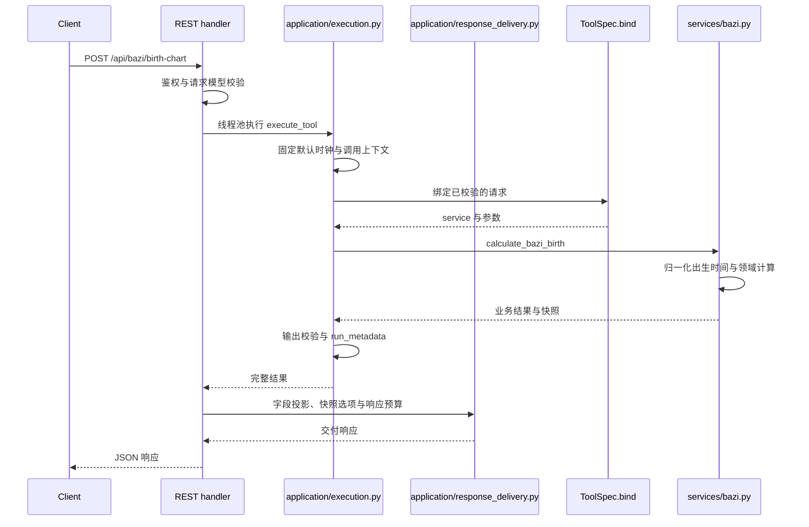

# FateBridge 架构说明

[文档中心](README.md) · [开发指南](development-guide.md) · [核心概念](concepts.md)

一次计算会经过接入校验、共享执行、领域服务与结果交付。沿着这条链路，可以追溯响应从何而来、找到扩展或修复的位置，并判断哪些接口与合同需要一起验证。首次接入从[快速入门](getting-started.md)开始，字段与路由查询使用 [API 参考](api-reference.md)。

FateBridge 的 Python 后端通过 REST、MCP 和 CLI 提供领域计算；仓库提供按需读取的方法参考。对话模型和产品界面由接入应用提供，整体分工见[核心概念](concepts.md#计算解读与对话的分工)。

引擎的输出以可核对的事实为单位。历法、几何、排盘和可复算的规则条件随所属领域计算；传统规则注明来源与适用条件，经典条目由查询入口按需读取。产品侧的行业映射、现代心理类比、择业建议和关系判断由 Agent 结合用户背景生成。投影与分页负责选择同一次计算的字段，业务层直接构造这些事实。

`src/fatebridge/services/catalog/` 按领域声明工具，`services/tool_catalog.py` 有序装配成唯一的 `CATALOG`；请求字段定义于 `core/requests/` 的领域模块。传输层复用服务和算法，但保留各端的绑定、名称和校验方式。

阅读导航：[系统概览](#系统概览) · [分层职责](#分层职责) · [典型请求流](#典型请求流) · [关键实现约束](#关键实现约束) · [依赖边界](#内聚与依赖边界) · [运行边界](#运行配置与边界) · [扩展验证](#扩展与验证)

## 系统概览

下图展示计算请求的后端执行链路。模型对话与结果解释在客户端或应用侧完成。

`application/tool_spec.py` 的 `ToolSpec` 是冻结 dataclass，包含 key、family、请求与输出模型、绑定器、各端名称、必需业务根和重计算标记。`core/response_models.py` 定义公开根契约，复用 `core/contracts/output_western.py`、`output_charts.py`、`output_chinese.py`、`output_bazi.py`、`output_reference.py` 的专业嵌套模型；它们继承 `output_base.PartialOutput`，支持部分响应、可空事实与增量扩展，只校验而不重写业务 JSON。目录将输出模型附到 ToolSpec；`rest_specs()` / `mcp_specs()` 过滤各端集合，注册器据此挂载入口，CLI 按模型生成参数。新增工具须同时声明响应字段契约。

`application/discovery.py` 在生成 Schema 前筛选目录，供 REST `/api/tools`、CLI `discover` 和 MCP 摘要/单工具资源共用。MCP host 的 family 配置只筛选注册表；默认保留完整集合。`ToolSpec.execution_hints` 是三端发现记录与 MCP annotations 的共同来源，描述环境影响，不描述数值确定性。

目录共有 93 条记录。OpenAPI 发布 93 个业务 REST 路由。FastAPI 提供 `GET /api/tools`、`/health`、`/ready`、`/metrics`。MCP 通过四个入口提供 93 项业务能力。CLI 可执行 93 条，并提供 `list`、`discover`、`describe`、`profile`、`doctor`。风水工具支持嵌套 JSON `--request-file`。

家居风水领域位于 `core/fengshui/`，请求、响应、公共方位、历法边界、八宅、年度飞星、玄空历史宅盘、砂水与可读快照各有模块。`services/fengshui.py` 只编排独立层和逐人差异，`data/fengshui/rules-v1.json` 保存版本与来源并随包发布。工具在中央目录显式绑定领域响应模型；`cli_request_file` 声明复杂 CLI 输入支持，不改变未启用工具的行为。规则与验收边界见 [家居风水](fengshui.md)。

三端共用公开工具名、请求模型和执行回执。REST 路由与工具名的映射见 [API 参考](api-reference.md#24-三端能力边界)。

## 分层职责

| 层 | 主要路径 | 职责 |
| --- | --- | --- |
| 工具声明 | `services/catalog/`、`services/tool_catalog.py`、`application/domain_plugin.py`、`application/tool_spec.py` | 领域声明、插件装配与不依赖协议框架的工具描述 |
| 应用编排 | `application/bindings.py`、`execution.py`、`response_delivery.py` | 请求绑定、统一执行与输出校验、投影和预算交付 |
| 能力发现 | `application/description.py`、`discovery.py` | 公共描述与目录筛选；共享描述避免反向引用 |
| 协议注册 | `transports/rest.py`、`mcp_server.py` | REST 路由与 MCP 工具的签名、注册、协议错误与输出选项 |
| 请求模型 | `core/requests/` | 公共校验基类、领域字段、默认值与取值范围 |
| 传输 | `api.py`、`mcp_server.py`、`cli.py` | HTTP/协议/参数处理，错误、元数据与输出包装 |
| 服务 | `services/*.py` | 调用核心、拼接分析、生成快照；`run_metadata.py` 生成响应溯源 |
| 分析 | `analysis/*.py` | 时运交互、结构前提及其他复合规则 |
| 核心 | `core/*.py`、`core/metaphysics/` | 历法、八字、占星、紫微、六壬、太乙等领域计算 |
| 子技法 | `core/predictive/`、`core/local_techniques/` | 西占推运和本地技法模块；两者均为目录，不是旧单文件模块 |
| 运行公共层 | `utils/birth_input.py`、`solar_time.py`、`formatting.py`、`elements.py`、`places.py`、`timezones.py`、`runtime.py`、`errors.py` | 出生输入、太阳钟、展示、五行关系、地点/时区、配置与错误 |
| 星历运行时 | `core/ephemeris_runtime.py` | 数据路径、模型标识、共享状态与并发保护 |
| 数据 | `data/knowledge/`、`data/canping/`、`data/heluo/` | 知识与条文 JSON，打包进 wheel |
| 导出 | `core/export_contracts.py`、`export_parser.py`、`services/structured_snapshot.py` | section 合同、文本解析与快照构造 |
| 验证 | `tests/`、`tests/data/`、`validation/` | 领域回归、独立参考、跨端对齐与离线审计。离线审计从源码检出运行，发布包仅包含运行时 |

## 典型请求流

### 独立八字命盘

`api.py` 不直接手工构造领域对象。`ToolSpec.bind` 通过公共绑定器构造请求，再交服务执行。REST 同步服务均在线程池执行，并在提交重计算前异步限流。`application/compute_limits.py` 在共享执行层用同一进程信号量限制 `cpu_bound` 工作，REST、MCP和CLI均遵守；上限来自 `FATEBRIDGE_HEAVY_CALC_MAX_CONCURRENCY`。发现记录的 `execution` 披露是否计入该预算。它限制进程内实际计算，不是跨进程队列或速率限制。

`bazi_overview` 的 MCP / CLI 绑定进入 `services/calculation.py::calculate_destiny_analysis`，在命盘之上组织综合分析。独立八字命盘绑定到 `services/bazi.py::calculate_bazi_birth`。九专题复用 `core/bazi/bazi_evidence.py` 的透藏、根气和结构前提。应用层通过紧凑视图和同次结果读取交付事实，`knowledge_catalog` 与 `knowledge_read` 提供按需的经典条目。Agent 根据用户问题决定取证范围，并结合实际语境生成解释。

### 快照与输出流

一次成功请求依次经过业务输出校验、执行回执、字段投影、快照选项和响应预算处理。这一顺序决定了保存与交付的数据范围。

支持双层快照的服务使用 `parse_export_content` 或共享快照构造器生成 `snapshot_text` 与 `snapshot_export`，覆盖见 [算法矩阵](algorithm-coverage.md#4-快照协议覆盖)。八字命盘和专项服务在精简模式按需生成快照。可用 `include_snapshot_text=true` 请求正文，或通过 `fields` 选择 `snapshot_text`、`snapshot_export`。`selected_sections` 筛选导出文本，显式选择没有命中时导出为空。

成功业务输出由共享模型验证，保留原有字段与数值。共享执行层附加 `run_metadata` 后，`application/response_delivery.py` 统一执行字段投影、顶层 `snapshot_text` 选项和响应预算；三端只负责参数绑定、序列化与错误表达。错误结果保留完整包络，不做字段投影或分页。MCP 返回 structuredContent、JSON text 和原生 isError；REST 返回 JSON 对象，CLI 写 stdout 并用退出码表达失败。MCP 前置 middleware 将模型错误转换为安全的统一字段提示，避免框架回显提交内容。完整选项见 [API 参考](api-reference.md#25-字段投影与输出体积)。

### 合同缓存

`core/schema_cache.py` 缓存公开 Schema：按实际模型类、core schema 身份及完整结果必需根声明区分，每类缓存最多 256 条；模型 `model_rebuild()` 后自动使用新版本，公开 Schema 返回深拷贝。

动态修改模型配置、Schema hook 或嵌套模型而未重建根模型时，需要调用 `clear_contract_caches()`。业务输入、输出、调用时间和 execution receipt 仍逐次生成。共享执行层在领域返回后校验完整业务结果，附加 receipt 时单独校验回执。完整结果必须包含非 null 且非空对象的 `ToolSpec.required_output_fields`。共享 `PartialOutput` 根据完整执行上下文核验 `FULL_FACT`／`PRESENT_FACT`、集合唯一性及必要成员。公共投影允许省略对象字段，合法空列表按各领域合同保留。无效的错误包络按内部输出错误处理。

### 大结果交付

`application/result_delivery.py` 将超预算响应的所选字段和快照写入按操作系统用户隔离的私有临时目录。每次交付保存一个 JSON 文件，包含 `payload`、过期时间及内部摘要。客户端可逐页或按字段读取，也可通过 `GET /api/results/{result_id}/payload` 一次下载所选响应。要导出完整业务结果及审计回执，首次请求使用 `detail=audit` 和 `fields=null`。

跨进程锁覆盖写入、原子发布和容量回收。读取从已发布的文件取得完整对象，再选取字段或字符页。POSIX 使用仅所有者可访问的权限和 flock。Windows 通过 pywin32 使用用户 SID、私有 ACL 与原生文件锁，并拒绝重解析点。`parent_run_id` 用于关联调用，同一次结果通过 `result_id` 读取。

核验读取使用已发布的私有文件，核对期限、完整 `payload` 的内部摘要、原 `run_id` 和适用的工具公开范围，再从同一对象选页。并发回收可能令结果不可用。只读客户端按结果 ID 查找既有缓存，CLI 可显式指定原私有目录。写入时才选择可写临时目录。

原生 MCP 从投影后的字典直接生成 `structuredContent`，失败时另外提供简短错误消息。协议工具仅通过原生 FastMCP 调用，REST 通过已挂载路由调用；旧 Python 别名和模块级 `.fn` 包装已删除。内部导入使用定义模块（如 `utils.errors`、`core.requests`、`core.predictive` 的具体子模块），不依赖兼容重导出。

## 关键实现约束

### 出生时间与分析时钟

出生输入构造与校验集中在 `utils/birth_input.py`，太阳时归一化集中在 `utils/solar_time.py`，时区解析集中在 `utils/timezones.py`。中式出生模型默认开启太阳时、核心星盘默认关闭；缺省值和用户显式选择有不同的缺经度处理，不可在适配层丢失。四柱年/月与节气、起运按实际民用时刻，日/时柱等遵循太阳钟规则；应保留原始时刻与修正结果供复核。

式占及本地组合工具共用 `core/metaphysics/seed.py`。数字分析字段和日期／坐标字符串各在入口解析，再交给同一个修正与种子装配所有者；有范围限制的 Person 入口复用已经算好的出生校正，不重算均时差。`MetaphysicsSeed.input_datetime` 是已解析、带时区的实际民用时刻，`clock: NominalClockLabel` 仅保存所选钟面的 Gregorian 日序与日内微秒。`input_offset_visible` 只保留原请求的后缀展示，不形成第二份时钟事实。

太阳标签保留原 `timedelta(minutes=total)` 量化后用整数进日，不附 IANA 区、不反解 UTC／TT，也不借四百年代表日期伪造农历来源。年／月和交节仍消费实际民用时刻；日／时及农历日期消费所选标签，农历先核日序覆盖再构造有界日期。ISO 解析位于无民用消歧依赖的 `utils/iso_clock.py`，避免民用解析与扩展 UTC 日历互相依赖。[本轮表示边界与有限接受](calendar-boundary-audit.md#nominal-clock-labels-round33)另列，不能据内部类型推定完整精度。

### 星历模型与共享状态

核心占星可走本地 `swisseph` 或轨道近似路径，显式复杂宫制缺运行时则报错。西占推运、事件和生命周期依赖 backend，缺失时不使用 FateBridge 的轨道近似替代。包可导入仍不保证星历数据存在，实际模型需检查 `ephemeris_model` 与 `engine_is_approximate`，详见 [算法覆盖](algorithm-coverage.md)。

Swiss Ephemeris 存在共享 C 状态。直接调用与会修改目录的第三方调用通过 `ephemeris_runtime.py` 的可重入锁协调；第三方操作正常或异常结束都应恢复配置目录。新增星历调用应复用这一层，避免跨请求的目录漂移。

### 执行回执与重放

`run_metadata` 在原 ID、时间、引擎与近似标志上增加版本、实际时间与重放参数。`application/execution.py` 的 `execute_tool` 包装现有 `execute_spec`，REST 由原执行器限制重计算并发并卸载到线程，MCP / CLI 共用执行层；execute_spec 保留无元数据的服务调用契约。ContextVar 隔离默认时钟，无 seed 随机六爻保留本次 seed，没有运行数据库。重放需要保存原始请求和环境，`run_id` 本身不能查询或恢复一次计算。

`execute_spec` 解析完整业务合同，领域检查可复用已解析对象，对照原请求与同次计算依据。回执单独构造和验证。知识服务在取读时核对所用来源，输出边界核对领域、分类和条目身份。三端共用 `detail` 和 `fields` 的交付逻辑。`compact` 在缺省字段时使用领域首轮视图，并保留有效时间和重放 seed。支持可选快照的服务按请求生成正文和导出。需要完整业务结果及审计回执时，首次调用指定 `detail=audit` 并省略字段投影。超过预算时沿同一 run 的引用读取。

领域目录用 `DomainPlugin` 组装 `ToolSpec`。结果校验和首轮视图由工具声明，共享交付层只负责字段投影、回执和预算。新增领域可直接使用自己的 Pydantic 请求模型。

### 工具发现

工具发现直接从实时 `ToolSpec` 目录生成。REST、CLI 与 MCP 资源按名称、family、关键词和接口筛选；MCP 可用 `FATEBRIDGE_MCP_FAMILIES` 限制注册范围。发现层不加载主题 YAML、生成的场景清单或预设工具依赖。

### 方法合同与数量语义

`core/method_contracts.py` 与 `services/method_registration.py` 维护领域方法合同。当前 93 条公开目录记录关联 66 个唯一 `method_id`。性格入口分别声明出生前置和文化词典的用途。完整发现返回 `method_contracts/method_registration`，摘要返回 `method_ids`。`detail=audit` 在 `run_metadata.calculation_evidence` 返回启用的方法和声明误差预算，业务结果提供规则轨迹和来源。依赖图与数学关系重建由离线审计调用。

共享证据层绑定全部业务根、输入提供状态和环境，解析已有领域账本中的具名依赖，检查DAG闭合并支持保守失效传播。误差预算区分已知界、声明范围、未量化和不适用；没有传播依据时不生成输出误差界。声明依赖、包含与规则输入见证分开，未决语义依赖保持显式，详见[计算证据合同](computation-evidence.md)。完整业务覆盖不等于全部细粒度因果关系或连续稳定性已被证明。

## 内聚与依赖边界

入口和协议适配器调用应用层，应用层调用领域服务，领域服务调用 `core`、`analysis` 与公共工具。`services/tool_catalog.py` 是装配入口，可以依赖应用层的 `ToolSpec` 与绑定工厂；普通领域服务不依赖协议适配器。`application` 不导入 FastAPI / FastMCP，动态协议签名由 `transports` 生成。

| 关注点 | 当前模块与维护规则 |
| --- | --- |
| 出生公共计算 | `services/birth_context.py` 复用归一化、四柱与历法；`birth_payload.py` 构造公共命盘响应 |
| 时运与日历 | `services/timing.py` 编排时运，`timing_clock.py` 归一化分析时刻并读取 `core.execution_context` 的执行时钟，`timing_state.py` 计算各层状态，`timing_snapshots.py` 组织文本；日历查询用 `calendar_tools.py` / `calendar_input.py` |
| 星盘 | `core/astro/` 按出生、几何、星历、宫位、盘面与关系盘拆分；公共星座、庙旺和界表位于 `core/astro/astrology_tables.py` |
| 请求模型 | `core/requests/base.py` 管理未知字段和日期校验；`birth.py` 管理出生基类，领域模块直接导入所需类型 |
| 工具声明 | `services/catalog/` 各领域拥有 `SPECS`、绑定和延迟服务代理；不反向导入中央装配器或提前加载计算引擎 |
| 西占单项时运 | `services/western_timing_tools.calculate_timing_tool` 承担共同执行；目录通过绑定参数选择技法，标签与公开入口仍由各条 `ToolSpec` 声明 |
| 本地技法快照 | `core/local_techniques/snapshot.py` 提供共享文本原语；纯四卦组合不为渲染文本加载星盘计算入口 |
| 输入与展示 | `utils/birth_input.py`、`solar_time.py`、`formatting.py`、`elements.py` 各自承担单一公共职责 |
| 领域共享定义 | 河洛卦关系、人类图 mechanics、六壬约定、金口诀表与太乙几何由各领域的定义模块维护；计算入口和规则消费者共同依赖定义模块 |
| 人类图知识 | `human_design_line_catalogue.py` 维护基础目录，版本化读者依赖基础目录；`human_design_knowledge.py` 负责版本分派 |
| 星历来源 | `physical_source_observation.py` 记录来源，`physical_ephemeris_policy.py` 管理外层策略；运行时向策略与压缩星历传入实际 native 对象、探测和路径回调 |
| 完整结果校验 | 金口诀完整课体的气状态校验与参平年序绑定分别由 `output_jinkou_course_qi.py`、`canping_schedule_validation.py` 承担；字段模型与底层规则不反向导入完整输出模型 |

共享定义留在对应领域，避免消费者为了取常量、类型或纯计算函数导入完整排盘入口。函数内导入同样计入依赖图；延迟导入用于控制加载成本，不用于隐藏循环依赖。当前实现按独立参考、完整业务输出及领域回归验证，验收方法见[开发指南](development-guide.md#测试策略)。

`tests/quality/test_architecture_boundaries.py` 检查核心/分析/工具层不依赖应用与协议层、应用与服务不依赖协议适配器或旧兼容入口，并核对含函数内导入的静态导入图无循环。它不分析动态 `importlib` 调用或第三方库内部依赖。

## 历法与星历依赖

修改共享历法时，先沿实际消费路径确定影响范围。下表列出已核对入口，并非穷尽所有间接调用。数值、时标、民用转换及边界两侧的领域分类分别验证；不同模型的通过结果不能抵销原模型失败。

| 依赖 | 已核对的消费路径 | 修改时重点 |
| --- | --- | --- |
| `core/almanac.py` 的节气年表和相邻节气 | `services/calendar_tools.py`、`core/timing.py`、`core/metaphysics/ren_calendar.py`、`core/local_techniques/sixyao.py`、`core/fengshui/calendar.py`、`core/fengshui/monthly_time.py` | 分别检查实际提供者、TT 交点、民用时间转换及各消费者在边界两侧的分类。六爻的备选路径回执使用已经选定的月界。[六壬审计](liuren-jinkou-audit.md) · [风水历法审计](fengshui.md) · [六爻节月对照](precision-acceptance.md#sixyao-selected-analytic-month-round50) |
| 同一节气年表的河洛／参评路径 | `core/heluo/heluo_solar_context.py`、`core/heluo/heluo_seasonal.py`、`core/numerology/canping_solar.py` | 河洛绑定当前节气、前一至点及下一四立；参评还取投影立春。保留实际消费的模型与来源，不能用另一路模型的通过结果改写 Native 失败。见[太阳模型边界](solar-backends.md)。 |
| 农历日期与时区 | `core/ziwei/ziwei_age.py`、`core/ziwei/ziwei_calendar.py` | 安星时钟、岁序参考时钟与目标流曜时钟各有职责；修改其中之一应检查其他输出是否被误改。见[紫微岁序](ziwei.md#时钟与岁序)。 |
| Swiss 星历与时间尺度 | `services/human_design.py` 及人类图计算链 | 按实际旗标和文件核对出生及设计时刻，分别检查后端对坐标、太阳根和细分的影响；不能仅以可导入库判断使用了数据文件。见[人类图验收](human-design.md)。 |

这些路径共享某些基础组件，不意味着它们的全部历法策略、覆盖年份或后端选择相同。扩展影响范围时应沿实际调用链核实。

节气数值主点与民用显示分开保存：`utils/civil_time.CivilPoint`仅负责精确名义Gregorian日分数、有效区间的显示上限和纯日历舍入；`core/astro/time_scales.utc_point_from_tt`负责唯一的时标反解与原有资格限制。工具层不反向依赖天文模块。`SolarTerm`将所选TT、精确民用点和带时区日历缓存到同一记录，年／月分界和河洛季节比较消费保留点；微秒标签只用于展示。名义民用日差不等于跨闰秒的均匀SI时长，土用十八日沿用名义民用日政策。

天文钟载体`UTCClock`与`EphemerisTime`只保存一个可空`TTInstant`，`jd_tt`是由它导出的标量适配。精确原子UTC入口保留日分数；显式float入口只保留原IEEE点，不恢复已丢失的位数。离线星历、相对历元、岁差章动及目标几何沿实际参数传递该点，`shifted_by`先累加局部日差。需要两部日期的ERFA入口消费最近标量及精确舍入残差，不先把两部加回大JD；需要单个double的原生SDK在调用边界显式舍入。原生射线的源基底仍匹配SDK实际标量历元，不能给原生角度附上另一个精确点的源框架。

私有原生worker协议通过独立`tt_instant`类型信封传递整数分子／正分母，再由同一`EphemerisTime`重建；它没有公开JSON的第二个时间真值。公开日期与JD字段继续按各自合同显示。C04、默认ΔT和原生SDK的标量限制，以及原子UTC前未知或模型TT的来源资格继续明确保留。有限精度与协议证据见[保留TT主点](precision-acceptance.md#retained-primary-tt)。

源多项式的数学所有者是纯模块`core/astro/chebyshev.py`，不读取文件或调用原生引擎。DE440、原始DE441及打包DE441的所有者负责各自record、系数和单位；它们将Fraction局部坐标交给同一full-c0解析导数递推。`ChebyshevKinematics`内部保留位置及两阶导数的高低分量，单位换算和Earth／Moon源组合完成后才交付float，避免消费者从已显示数恢复精度。两分量近似有明确EFT前提，不能据固定控制的最近舍入结果宣称任意输入精确或修复量化源模型，详见[分层验收](precision-acceptance.md#compensated-source-polynomial)。

奇门置闰的`core/qimen/qimen_calendar_anchors.py`只取得前一年大雪、当年芒种及大雪，由实际计算与来源回执共用。各邻年仍复用共享almanac的原模型选择及私有guard授权；实际来源验证先于派生调度缓存。调度内部只用连续Gregorian日序，显示键显式格式化；来源回执的年份集合表示实际观察的锚点年份，不代表读取整年。拆补来源复用已有当前节气，不为回执重算无关年份，详见[奇门年界](calendar-boundary-audit.md#qimen-private-calendar-guards)。

推运的`NativeSubject`只保存`tt: TTInstant`，`julian_day_tt`为派生SDK／显示适配；构建者用同一个保留点计算目标宫位、宫轴与高度。主限的`PrimaryDirectionEquatorialContext`一次携带TT、UT1及实际投影几何，取代会提前舍入的字典和多组标量参数；它是内部领域对象，不放进公开JSON。印占`positions`同样把保留点交给目标姿态、managed houses／sidtime及旋转政策，native行星、ayanamsha、motion及均值receipt仍使用实际SDK标量。返照的已知民用标签只能见证相同SDK查询，不能由此证明标量根与精确输入点相等或连续真实事件不晚于分析时刻，见[后续验收](precision-acceptance.md#retained-target-tt)。

共享太阳钟的`SolarClockContext`只携带实际UT1和唯一TT，供`_sun_clock`消费。已知civil forward直接保点；UT1逆解只能保原模型返回的IEEE点，不能补造原子UTC信息。上下文不进入旧太阳钟JSON，所有SDK／回执JD仍显式float；只需UT1与经度的LMT支路不增加Sun／TT资格。果老目标几何、原生历元年／节月成员与TT间隔也消费保留点，来源射线仍按实际SDK标量解码。返照在已有单函数内求到不能再表示中点为止，避免尚有可计算中点时提前退出，不额外抽取通用求根框架。范围与未决见[太阳钟／果老](precision-acceptance.md#solar-guolao-primary-tt)及[原生返照收敛](precision-acceptance.md#native-return-resolution)。

公开`civil_point`的分子、分母均为十进制字符串，完整回执显式包含`excluded_before`（无上限为null）；投影缺少该键表示上限未知，不能据此补成无上限或查询当前钟表。共享输出类型在`output_civil_time`，避免中文结果与河洛输出互相导入。保留点的数值精度、显示位数与物理准确度分别说明，有限边界一致性不构成完整算法或预测认证。

起运由`TimingAnalysis.resolve_dayun_start`返回typed `DayunStartResolution`，保留实际SolarTerm、localized birth、方向／年干和精确名义日差；旧details接口只作同次十一字段JSON适配。事件消费者直接取得来源，不从reference_term显示JSON重建root。实际wall直接以精确名义日差乘整系数后，单次半偶舍入至偏移微秒；details的旧float显示顺序保留，不再作为wall算术的输入。360／30日分解、公历加法及DST策略继续由原时运所有者处理，不能据量化修复认证全部连续事件。

`nominal_calendar_bracket(day)`是共同的纯floor／ceil微秒包络，供CivilPoint方法和事件输出验证复用，不消费显示cap或提供ordinary clock资格。事件的`nominal_gregorian_microsecond_enclosure_v1`明确描述名义点外包，at_utc为上端代表格点；它不替代实际rounded-wall逆像或连续候选完整性。partial缺cap时验证器只核对已知分数及端点，不构造无cap点。

### 星历路径解析的一致性

`core/ephemeris_paths.py` 统一处理星历目录列表，供安装提示、`doctor` 的风水／人类图检查、节气缓存、运行来源记录及梅花历法审计使用。Unix 同时支持冒号和分号，Windows 保留盘符冒号；原有目录顺序和相对路径含义保持。路径约定参照 [Swiss 官方接口文档](https://www.astro.com/swisseph/swephprg.htm)及[原生文件搜索实现](https://github.com/aloistr/swisseph/blob/master/sweph.c)。

此前在 Unix 使用 `SE_EPHE_PATH=first;second`，诊断与安装提示会将其视作单个目录，和节气缓存及来源记录的解析不一致。统一后可逐目录报告实际文件状态，并正确识别新文件目录已在搜索路径中。连续分隔符合并处理，依据[原生 `swi_cutstr` 实现](https://github.com/aloistr/swisseph/blob/master/swephlib.c)，不再将列表中间的空段当作额外当前目录写入缓存及来源记录。此项修复针对文件就绪诊断和目录清单，不改变太阳模型、交气数值或上表的固定失败。

当前未决项由各专题维护：[太阳模型](solar-backends.md)、[六壬分钟标签](liuren-jinkou-audit.md)、[紫微岁序](ziwei.md#时钟与岁序)及[人类图精度](human-design.md)。固定样本、分母和容差随原参考保留，汇总见[算法状态](algorithm-status.md)。

## 运行配置与边界

REST 默认监听 `0.0.0.0:8010`，可选 API Key 鉴权；CORS、运维路径豁免和配置加载见 [运行配置](configuration.md) 与 [安全策略](../SECURITY.md)。FastMCP 默认使用 stdio，由 host 启动子进程。CLI 不需要 REST 服务，`profile` 可为同一命主编排多套盘，`--subject-file` 复用出生信息。

当前项目不包含内置 Web 前端、持久化运行数据库、账户体系、队列或多服务编排。大结果交付仅提供有有效期和容量上限的本地临时文件，不是历史查询服务。网络访问与生产控制由部署方的网关和 host 承担。

## 扩展与验证

新增能力通常先实现 `core` / `analysis`，封装 service 和 request model，再追加 `ToolSpec`。常规新增工具无需手工修改三个 transport 的领域入口，但只有声明对应 surface 且 CLI 模型可表达时才会实际暴露。

为新工具补 `tests/fixtures/surface_payloads.py` 的代表请求，运行领域回归与 `test_full_surface_validation.py`；涉及输出、默认值或投影时补跨端对齐证据。文档与生成合同同步方式见 [开发指南](development-guide.md#文档维护与验证)。独立参考与 CI 运行范围也在那里统一维护。

玄空版本独立放在 `data/fengshui/xuankong-v1.json`，与基础规则版本分别发布。`core/fengshui/xuankong.py` 只使用历史定运及磁北宅向，按输入误差解析候选角区；合参新增的是独立层，不给年度盘添加山向星，也不按当前元运重算宅盘。详见 [来源与合同](fengshui-xuankong.md)。
