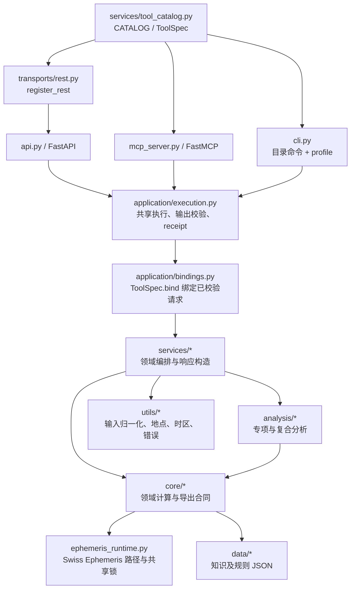
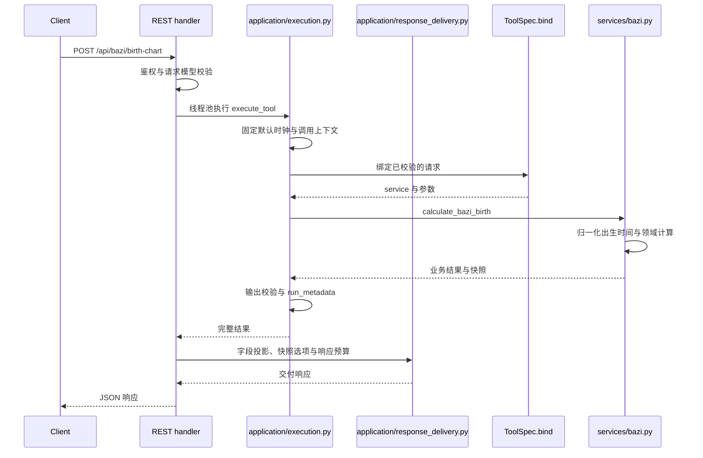

# FateBridge 架构说明

[文档中心](README.md) · [开发指南](development-guide.md) · [核心概念](concepts.md)

FateBridge 的计算请求依次经过传输校验、共享执行层、领域服务与结果交付。本文说明代码分层、请求流向与核心依赖边界；接口与参数细节见 [API 参考](api-reference.md)，初次使用见[快速入门](getting-started.md)。

## 系统概览

`services/catalog/` 按领域声明 `ToolSpec`，`services/tool_catalog.py` 将其有序装配为唯一的中央目录 `CATALOG`；请求模型位于 `core/requests/`，响应根模型与嵌套契约位于 `core/response_models.py` 及 `core/contracts/`。

目录共有 93 条记录。OpenAPI 发布 93 个业务 REST 路由，FastAPI 另提供 `/api/tools`、`/health`、`/ready` 与 `/metrics`。MCP 通过四个入口提供 93 项业务能力。CLI 可执行 93 条目录命令，并提供 `list`、`discover`、`describe`、`profile`、`doctor` 与 `result-read`。各端入口映射见[三端能力边界](api-reference.md#24-三端能力边界)。

## 分层职责

| 层 | 主要路径 | 职责 |
| --- | --- | --- |
| 工具声明 | `services/catalog/`、`services/tool_catalog.py`、`application/domain_plugin.py`、`application/tool_spec.py` | 领域插件装配与协议无关的工具描述 |
| 应用编排 | `application/bindings.py`、`execution.py`、`response_delivery.py`、`result_delivery.py` | 请求绑定、统一执行、输出校验、字段投影与超预算交付 |
| 能力发现 | `application/description.py`、`discovery.py` | 三端共用的工具摘要与 Schema 筛选 |
| 协议传输 | `transports/rest.py`、`api.py`、`mcp_server.py`、`cli.py` | REST 路由注册、FastMCP 协议工具与 CLI 参数生成 |
| 请求与响应模型 | `core/requests/`、`core/response_models.py`、`core/contracts/` | Pydantic 输入校验、输出根契约与 `PartialOutput` 嵌套模型 |
| 服务与分析 | `services/*.py`、`analysis/*.py` | 领域编排、时运复合分析、快照构造与 `run_metadata` |
| 核心计算与数据 | `core/*.py`、`core/metaphysics/`、`core/predictive/`、`core/fengshui/`、`data/*` | 各体系算法实现、知识条目、规则表与内置数据 |
| 公共基础与导出 | `utils/*`、`core/ephemeris_runtime.py`、`core/export_contracts.py`、`core/export_parser.py` | 出生时间/地点/时区、星历共享锁、统一错误与快照导出解析 |
| 测试与工具 | `tests/`、`scripts/` | 领域回归、三端契约检查与文档/合同生成校验 |

## 典型请求流

### 执行与输出管线

所有传输层均通过 `application/execution.py` 调用领域服务，重计算由 `application/compute_limits.py` 按 `FATEBRIDGE_HEAVY_CALC_MAX_CONCURRENCY` 进行进程内信号量限流。请求成功返回后，共享交付管线依次执行：业务输出合同校验 -> 附加 `run_metadata` -> 字段投影（`fields` / `strict_fields`）-> 顶层 `snapshot_text` 开关 -> 响应字符预算与 `result_delivery` 分页存储。

### 合同缓存与大结果交付

`core/schema_cache.py` 按模型类与必需根声明缓存公开 JSON Schema（每类最多 256 条），动态重建模型后可通过 `clear_contract_caches()` 清理缓存。超预算响应由 `application/result_delivery.py` 写入用户隔离的私有临时目录（POSIX 使用仅所有者权限与 `flock`，Windows 使用用户 SID、私有 ACL 与原生锁），通过 `result_id` 与原 `run_id` 提供同一次运行的分页、点路径与完整性校验读取。

## 关键实现约束

- **时间与地点归一化**：出生输入构造集中在 `utils/birth_input.py`，真太阳时在 `utils/solar_time.py`，时区在 `utils/timezones.py`，离线地名解析在 `utils/places.py`。中式模型默认开启真太阳时，核心星盘默认关闭，适配层须保留该语义。
- **星历共享状态**：Swiss Ephemeris 存在共享 C 目录状态，所有目录切换与调用通过 `core/ephemeris_runtime.py` 与 `core/ephemeris_paths.py` 的可重入锁协调。核心占星盘缺省数据时可走内置近似路径，西占推运缺运行时则直接报 `dependency_missing`。
- **执行回执与重放**：`run_metadata`（格式版本 2.0）保存有效时钟、`determinism` 与 `replay.overrides`；随机起卦保留当次 `seed`。重放需保留原始输入与环境配置，服务不持久化历史运行数据库。
- **方法登记**：`core/method_contracts.py` 与 `services/method_registration.py` 维护各工具对应的唯一 `method_id`、依赖声明与来源范围；`detail=audit` 时通过 `run_metadata.calculation_evidence` 输出方法与误差边界说明。

## 内聚与依赖边界

传输适配层（`api.py`、`mcp_server.py`、`cli.py`、`transports/`）调用 `application/`；`application/` 调用 `services/`；`services/` 调用 `core/`、`analysis/` 与 `utils/`。`core/`、`analysis/` 与 `utils/` 禁止反向导入 `application/` 或传输层。`tests/quality/test_architecture_boundaries.py` 静态校验模块导入方向与无环依赖。

| 关注点 | 模块与维护规则 |
| --- | --- |
| 出生公共计算 | `services/birth_context.py` 与 `birth_payload.py` 复用出生归一化与公共命盘构造 |
| 时运与日历 | `services/timing.py` 编排时运，`timing_clock.py` 读取 `core.execution_context` 执行时钟；日历查询在 `calendar_tools.py` |
| 星盘与子技法 | `core/astro/`、`core/predictive/`、`core/local_techniques/` 按领域目录组织，共享星座与尊贵表位于 `core/astro/astrology_tables.py` |
| 领域共享定义 | 各术数、河洛、人类图与风水共享定义留在本领域定义模块，计算与消费端共同引用，不引入反向依赖 |
| 家居风水 | `core/fengshui/` 按八宅、砂水、年/月星、玄空与布局分层实现，`services/fengshui.py` 编排多层合并与 `cli_request_file` 支持，详见[家居风水参考](fengshui.md) |

## 运行配置与边界

REST 默认监听 `0.0.0.0:8010`，支持可选 API Key 鉴权与 CORS（见[运行配置](configuration.md)与[安全策略](../SECURITY.md)）；FastMCP 默认使用 stdio。FateBridge 不包含内置 Web 前端、持久化运行数据库、用户账户体系或多服务队列。

## 扩展与验证

新增工具通常按 `core` / `analysis` -> `services` -> `core/requests` / `core/response_models` -> `services/catalog`（追加 `ToolSpec`）顺序实现，并在 `tests/fixtures/surface_payloads.py` 补充代表请求后运行三端契约与领域回归测试。详细验证命令与文档生成规则见[开发指南](development-guide.md)。
